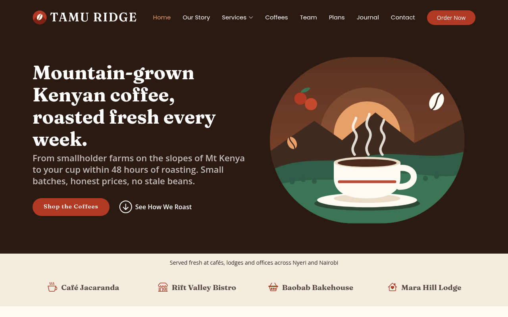

# Tamu Ridge Coffee Co.

A responsive, static website for **Tamu Ridge Coffee Co.**, a small-batch Kenyan coffee roastery and subscription brand in Nyeri. It is a **fictional brand** created for an eMobilis web development course project. Names, prices, stockists and testimonials are illustrative.

Built by **Mary Syokau** as an eMobilis web development assignment.



## Pages and features

- `index.html`: hero, stockists slider, story, FAQ accordion, cup profile (animated bars), services, farm-to-cup steps, call to action, filterable coffee grid with lightbox, team, monthly plans, testimonials slider, FAQ, roast-drop sign-up, journal teaser and contact form.
- `service-details.html`: four services in one page (subscriptions, office supply, workshops, gifting).
- `coffee-details.html`: six coffees and kits, each with a profile table.
- `blog.html` and `blog-details.html`: four journal articles.
- `delivery-terms.html`: delivery, payment, subscriptions, freshness promise and privacy.
- `404.html`: friendly "page not found" page.
- Responsive layout, keyboard-friendly menu and FAQ, no placeholder text, original SVG illustrations only (no stock photos), works offline apart from web fonts.
- The contact form opens a pre-filled **WhatsApp** message (with an **email** fallback). There is no server code.
- Detail pages use a tiny "hash panel" script (`assets/js/site.js`): one HTML file holds several items and `page.html#slug` shows the chosen one. Without JavaScript all items are simply shown one after another.

## Run it

No build step. Either double-click `index.html`, or serve the folder:

```
python3 -m http.server 8000
```

then open <http://localhost:8000>.

## Project structure

```
index.html
service-details.html
coffee-details.html
blog.html
blog-details.html
delivery-terms.html
404.html
README.md
.gitignore
docs/screenshot.png
assets/
  css/main.css           template styles, re-themed, plus a "Tamu Ridge customisations" block at the end
  js/main.js             template behaviour (menu, scroll spy, sliders, filters)
  js/site.js             hash panels, WhatsApp/email contact form, share links
  img/                   logo, favicons, og-image.png and all SVG illustrations
  vendor/                Bootstrap, Bootstrap Icons, AOS, GLightbox, Swiper, Isotope, imagesLoaded, Waypoints
```

## How I customised the template

- **Palette and fonts:** blue theme replaced by espresso, cream and coffee-cherry red (CSS variables at the top of `main.css`); headings use Fraunces, body Open Sans, menu Poppins.
- **Imagery:** every template photo was replaced with original SVG artwork (logo, favicon, hero, product bags, services, journal, initials avatars, map). Social preview image `og-image.png` is generated from the same art.
- **Contact form:** the template's server-side form (which cannot run on static hosting) was replaced by a WhatsApp/email handler; the `forms/` folder and its validation library were removed.
- **Sections:** each template section was given real content (cup profile bars, plans in KES, farm-to-cup steps, journal). Unused extras (comment sections, search, pagination, newsletter, social profile icons) were removed because they cannot work without a back end.
- **Navigation:** all links were fixed so the menu works from every page.
- **Added:** hash-panel detail pages, local map card instead of an embedded map, accessibility labels, contrast-checked colours.

## Before you publish

These values are **placeholders**. Replace them before the site goes public.

- [ ] **WhatsApp number**: currently `254700000000` (shown as `+254 700 000 000`). Replace in one go (use your own number, digits only, with country code):
  ```
  grep -rl 254700000000 . --include=*.html --include=*.js --include=*.md | xargs sed -i 's/254700000000/2547XXXXXXXX/g'
  grep -rl '+254 700 000 000' . --include=*.html --include=*.js --include=*.md | xargs sed -i 's/+254 700 000 000/+254 7XX XXX XXX/g'
  ```
  The number also appears in `CONTACT` at the top of `assets/js/site.js`.
- [ ] **Email**: currently `hello@tamuridge.example` (a reserved, undeliverable address). Replace with a real one:
  ```
  grep -rl 'hello@tamuridge.example' . --include=*.html --include=*.js --include=*.md | xargs sed -i 's/hello@tamuridge.example/you@yourdomain.com/g'
  ```
- [ ] **Brand name**: "Tamu Ridge" is invented. A quick web search found no existing coffee business of that name, but this is not a trademark search. Check before showing it publicly, or swap in your own brand.
- [ ] **Social preview image**: the Open Graph tag in every page uses the relative path `assets/img/og-image.png`. Social sites need an absolute URL, so after publishing change it to `https://<user>.github.io/<repo>/assets/img/og-image.png`.
- [ ] **Your links**: your name (Mary Syokau) is already in the "Built by" line and the Credits section; add your GitHub profile link next to it.
- [ ] **Stockists, testimonials, prices, team and addresses** are fictional. Keep the footer disclaimer, or replace them with real information.
- [ ] **Enable GitHub Pages**: repository Settings, Pages, "Deploy from a branch", branch `main`, folder `/ (root)`.

## Credits and licence

- Template: Arsha by BootstrapMade (free licence: <https://bootstrapmade.com/license/>). The footer credit link is retained as the licence requires; do not remove it.
- Libraries: Bootstrap 5.3.3, Bootstrap Icons, AOS, GLightbox, Swiper, Isotope, imagesLoaded, Waypoints.
- Fonts: Fraunces, Open Sans and Poppins from Google Fonts (SIL Open Font License), loaded from the Google Fonts CDN.
- Illustrations, copy and brand are original to this project. Names, prices, stockists and testimonials are fictional, and any resemblance to real businesses is coincidental.
- Original content (c) 2026 Mary Syokau; template under the BootstrapMade licence. No separate open-source licence is granted for the template code.

## Known limitations

- **404 page on GitHub Pages:** a mistyped *nested* URL will serve `404.html`, but its relative CSS and JS paths will not resolve, so it may appear unstyled. This cannot be fixed without knowing the final URL.
- **Fonts** load from Google Fonts. Offline, the page falls back to Georgia and system sans-serif fonts. The privacy section of `delivery-terms.html` mentions this.
- **WhatsApp number and email** are placeholders until replaced (see the checklist).
- A future improvement could use a form service (for example Formspree) for a real contact form; it needs an account and was left out to keep the site dependency-free.
